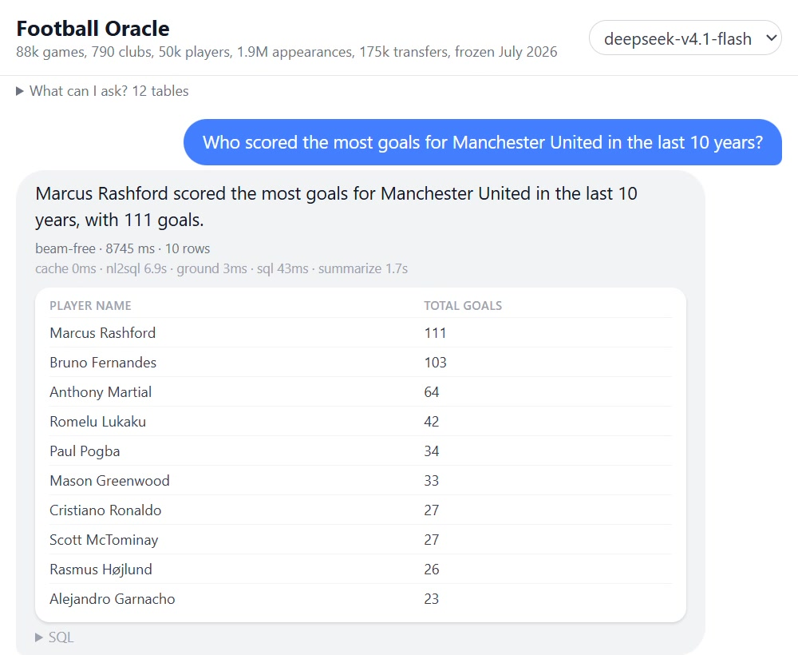
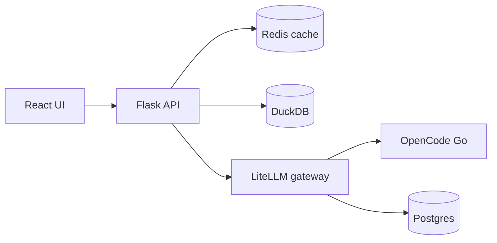

# Football Oracle

Ask a football question in plain English. Get a grounded answer, the generated SQL, and the rows behind it.

[](docs/demo.mp4)

90-second walkthrough from the AKS test run: ask a question, inspect the SQL and rows, then follow up. The AKS endpoint was intentionally torn down after recording.

## Highlights

- Natural-language questions over 14 seasons of Transfermarkt data (2012–2026): transfers, goals, appearances, valuations, and game events.
- Two model calls per question: English → DuckDB SQL, then rows → plain-English answer.
- Deterministic grounding between the calls: one `SELECT`, known tables and columns only, read-only DuckDB execution, and a hard timeout.
- Follow-ups work ("which club does he play for?") because the client sends recent turns; no server-side sessions.
- Exact-match answers are cached in Redis. The UI streams progress and the generated SQL, then exposes the rows behind each answer.

## Architecture



## Built with

- Flask + gunicorn for the API, React + Vite + Tailwind for the UI
- DuckDB for embedded analytics, sqlglot for SQL validation
- LiteLLM as the model gateway, with OpenCode Go behind it
- Redis for response caching, Postgres for gateway state
- Docker Compose, Kubernetes manifests, and Terraform for the AKS test run

## Getting started

### Prerequisites

- Docker + Docker Compose
- Python 3.13 and Node 20 (local development only)
- A Kaggle account for the data and an OpenCode Go key for live answers

### 1. Configure

```bash
cp .env.example .env
```

Set `OPENCODE_API_KEY` and `OPENCODE_SESSION_ID`. Keep `MOCK_LLM=1` for a no-key smoke test; set it to `0` for live answers. `APP_API_KEY` is the app-level access key embedded in the built UI. Keep `PG_PASSWORD` stable once the Postgres volume exists.

### 2. Build the data

```bash
pip install kaggle
pip install -r backend/requirements.txt
# Put kaggle.json in ~/.kaggle (Kaggle → Settings → API → Create New Token)
kaggle datasets download -d davidcariboo/player-scores -p data --unzip
python build_duckdb.py
```

This writes `data/football.duckdb` (~110 MB, 12 tables). Raw CSVs and the DuckDB file stay out of git. `game_lineups.csv` is intentionally excluded.

### 3. Run

```bash
docker compose up --build
```

Open <http://localhost:8000>. With `MOCK_LLM=1`, the app returns canned LLM responses and needs no provider key.

### Local development without Docker

```bash
cd frontend && npm ci && npm run build && cd ..
MOCK_LLM=1 python backend/app.py
```

On Windows, use `py -3.13` instead of `python`.

## Deploy to AKS

The full runbook is in [`docs/aks.md`](docs/aks.md). It creates a single-node free-tier AKS cluster, builds and pushes the image to ACR, creates the Kubernetes Secret from `.env`, applies the manifests, and tears the stack down again.

The AKS test run used one `Standard_B2as_v2` node (2 vCPU / 8 GiB) and was destroyed after the demo. It is not a permanently hosted service.

## How the guardrails work

1. **NL → SQL** — the prompt includes the live schema, competition coverage, season rules, and explicit `NOT_COVERED` behavior.
2. **Grounding** — sqlglot parses the response. It must be exactly one `SELECT`; every table and column must exist; slug `_code` columns are rejected in filters.
3. **Execution** — DuckDB opens read-only, the query runs with a 30-second timeout, and results are capped before they reach the summarizer.
4. **Rows → answer** — the second model call sees only the returned rows, so the prose is tied to the data rather than the model's memory.
5. **Cache** — exact question + history + model matches are stored in Redis for one hour.

The grounding layer catches malformed or out-of-schema SQL, but it is not a formal proof of semantic correctness. The model can still choose the wrong season, club, or comparison.

## Repository layout

```text
backend/          Flask API, pipeline, Dockerfile
frontend/         React/Vite UI
k8s/              Namespace, app, LiteLLM, Postgres, Redis
terraform/aks/    Azure resource group, ACR, AKS
docs/             Demo recording/poster and the AKS runbook
build_duckdb.py   Kaggle CSVs → DuckDB
docker-compose.yml
litellm.yaml      Model gateway configuration
```

## Data

The dataset is the Transfermarkt scrape by David Cariboo ([davidcariboo/player-scores](https://www.kaggle.com/datasets/davidcariboo/player-scores)), CC0 Public Domain, frozen in July 2026. The app covers 65 competitions. It is a snapshot, not live football data.

## Demo caveats and security

- This is a portfolio demo, not a production service. It runs one replica of each component and has no HA, rate limiting, or user accounts.
- `APP_API_KEY` is an app-level gate embedded in the built frontend. It is not a secret and is not a substitute for authentication.
- `.env` is gitignored. In Kubernetes the Secret is created from `.env` at deploy time; no secret manifests are committed.
- The AKS API server and app LoadBalancer are restricted to the deploying IP. Do not expose this demo publicly without an auth proxy and rate limits.
- Rotate provider keys if they were ever committed or shared outside `.env`.

## Contributing

Personal project, but feedback and issues are welcome.

## License

Code: MIT (see [`LICENSE`](LICENSE)). Data: Transfermarkt scrape by David Cariboo, CC0 Public Domain, frozen July 2026. The DuckDB file is rebuilt locally and is gitignored for size.

## Acknowledgments

- David Cariboo for the Transfermarkt dataset pipeline
- LiteLLM, DuckDB, sqlglot, Redis, and Postgres for doing the heavy lifting
